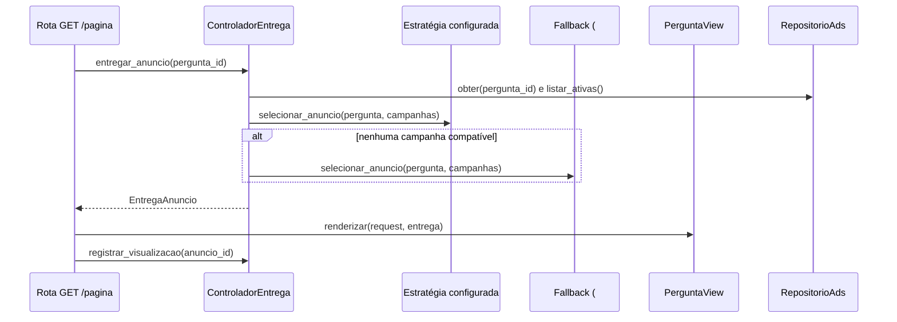

# Issue #27: ControladorEntrega, HTML SSR e métricas

Implementação do Context do padrão Strategy, da página da pergunta renderizada no servidor e do registro de cliques, consumindo os contratos da #24 e a estratégia da #25.

## Participantes do Strategy

| Papel no padrão (GAMMA et al.) | Classe | Arquivo |
|---|---|---|
| Strategy | `EstrategiaSelecaoAnuncio` | `model/strategies.py` (#24) |
| ConcreteStrategy | `EstrategiaMatchExatoDeTag` | `model/match_exato.py` (#25) |
| ConcreteStrategy | `EstrategiaMaiorSaldoNaTag` | pendente (#28) |
| ConcreteStrategy (fallback) | `EstrategiaAnuncioGenerico` | pendente (#26) |
| Context | `ControladorEntrega` | `controller/controlador_entrega.py` |
| Registro de políticas | `SeletorDeEstrategia` | `service/seletor.py` |
| Client | rotas FastAPI | `controller/rotas.py` |

O Context guarda a estratégia escolhida pelo seletor e delega a ela a seleção. Não há condicional específico de política: o único desvio é o fallback, executado quando a estratégia principal devolve `None`, como define o épico #23. Acrescentar uma política significa registrar a nova estratégia em `service/dependencias.py`; o Context e o seletor não mudam.

## Fluxo de uma exibição



## Rotas

| Método e caminho | Resposta | Erros |
|---|---|---|
| `GET /perguntas/{pergunta_id}/pagina` | 200, HTML com a pergunta e o anúncio | 404 pergunta inexistente; 422 UUID inválido; 503 política ou fallback não configurados |
| `POST /anuncios/{anuncio_id}/cliques` | 204, sem corpo | 404 anúncio inexistente; 409 campanha inativa ou sem saldo; 503 configuração |

As duas rotas aparecem no Swagger UI (`/docs`), na tag "Anúncios".

## Decisões

- **Caminho da página:** o PR #32 (SubEquipe_01) define `GET /perguntas/{pergunta_id}` em JSON. Registrar o mesmo caminho faria o FastAPI atender apenas a rota registrada primeiro, sem aviso. Por isso a página usa `/perguntas/{pergunta_id}/pagina`, alternativa prevista na própria #27. Unificar HTML e JSON em um caminho exige acordo com a SubEquipe_01.
- **Mesma aplicação FastAPI:** `subequipe3_strategy/main.py` importa o `app` de `subequipe1_factory_method.main` e acrescenta o router de Ads. Nenhum arquivo da SubEquipe_01 é alterado, e as rotas de Conteúdo continuam disponíveis.
- **Context por requisição:** `get_delivery_service` (nome do diagrama técnico) monta um `ControladorEntrega` novo a cada requisição, sobre um `RepositorioAds` compartilhado no processo. Não há singleton mutável de estratégia.
- **Política configurada:** vem da variável de ambiente `ADS_POLITICA` (padrão `match_exato`). Política não registrada responde 503 informando as opções disponíveis.
- **Visualização:** registrada uma vez por exibição, somente depois de a página ser montada. Selecionar, isoladamente, não registra eventos.
- **Escape:** título e tags passam pelo escape automático do Jinja2. O fragmento do anúncio só é marcado como seguro depois de o `AnuncioResponse` revalidar as URLs; o domínio da #24 já escapa o conteúdo do banner.

## Dependências pendentes

| Dependência | Efeito atual | Como fica após a integração |
|---|---|---|
| #26, `EstrategiaAnuncioGenerico` (Bruno) | `get_estrategia_fallback` responde 503. Como as duas rotas passam pelo `ControladorEntrega`, que exige o fallback, a página e os cliques ainda respondem 503 na aplicação real; os testes usam um dublê | Retornar a estratégia genérica em `get_estrategia_fallback` |
| #28, `EstrategiaMaiorSaldoNaTag` (Kaio) | Só `match_exato` está registrada | Acrescentar a estratégia na lista de `get_seletor` |
| #24 e #25 (PRs #33 e #34) | Esta branch parte de `feat/S1-estrategia-contextual` | Ajustar a base do PR depois do merge dos dois |
| Tags de Conteúdo (SubEquipe_01) | As perguntas vêm do seed de demonstração, não das criadas em `POST /perguntas` | Projetar as perguntas reais com `projetar_pergunta` quando Conteúdo fornecer tags |

## Limites

- **Deduplicação:** cada chamada de clique ou exibição conta como um novo evento. Não há chave de idempotência; recarregar a página conta outra visualização.
- **Concorrência:** o débito e a métrica são atômicos entre threads do mesmo processo, pelo `RLock` do repositório. Não há garantia entre vários workers nem persistência após reinício.
- **Leitura das campanhas:** a seleção lê saldo e status sem a trava. Uma campanha que se esgote entre a exibição e o clique é recusada no clique com 409.

## Executar e demonstrar

A partir de `codigo/`, com as dependências de `requirements-dev.txt` instaladas:

```bash
python -m pytest -q
uvicorn subequipe3_strategy.main:app --reload
```

Com o seed de demonstração (após a integração da #26):

| Página | Resultado esperado |
|---|---|
| `/perguntas/00000000-0000-0000-0000-000000000065/pagina` | Anúncio contextual "Curso de Python" (`match_exato`) |
| `/perguntas/00000000-0000-0000-0000-000000000066/pagina` | Anúncio genérico (fallback) |

Para alternar a política, iniciar com `ADS_POLITICA=maior_saldo` depois da integração da #28.
