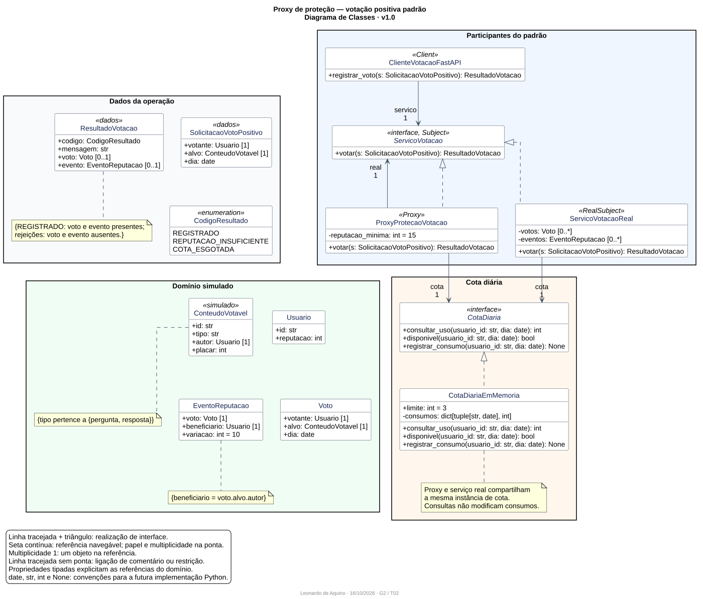
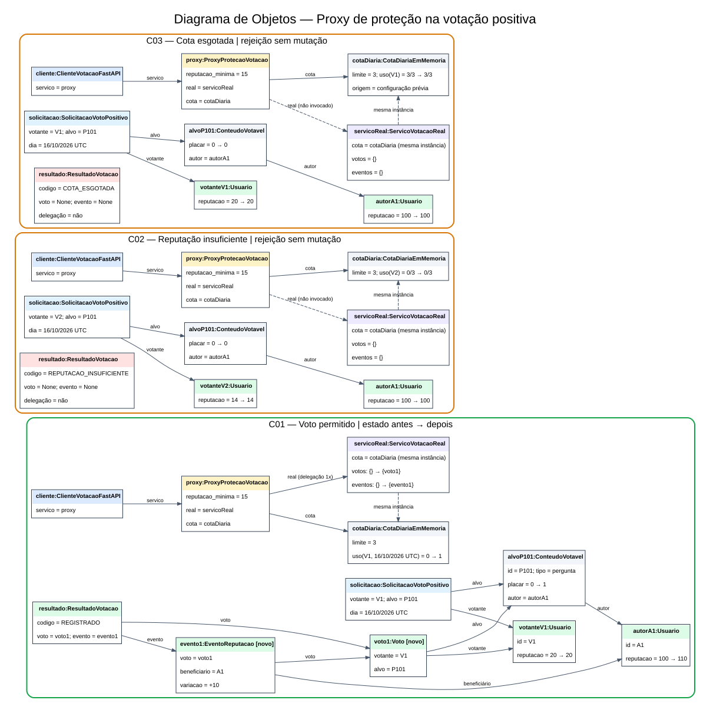
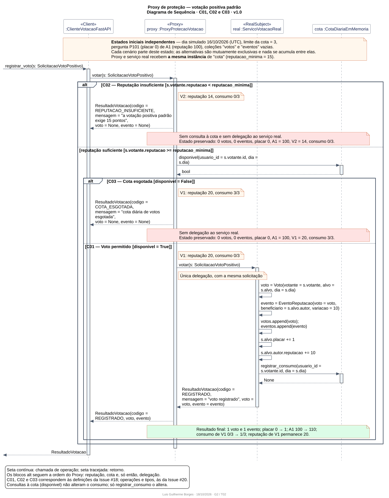

# SubEquipe_02
O relatório deverá conter a estrutura de focos estabelecida a seguir, bem como versionamentos, metodologia e participantes por foco.
Não omitir tópicos.

## Focos do Relatório:
### FOCO_02: GoFs Estruturais & IA Generativa
Entrega Mínima: um GoF Estrutural (modelo & código & vídeo com o padrão em execução).
### Participantes no Foco_02

| Nome do Membro | Lições Aprendidas | Uso da IA Generativa (SENSO CRÍTICO) |
| --- | --- | --- |
| Cauã Oliveira | Aprendi a elaborar um diagramas de objetos, compreendendo como representar instâncias concretas, seus atributos, relacionamentos e mudanças de estado em diferentes cenários. Também entendi um pouco mais sobre o padrão Proxy de proteção e sua aplicação no controle de votos positivos, considerando regras de reputação e limites de votação diária. | Utilizei a IA como apoio ao desenvolvimento, e não como substituta da análise técnica, sendo importante revisar os nomes das classes, os atributos e as regras de negócio para garantir a compatibilidade com o modelo do projeto, além disso, usei a IA na produção e auxilio do código do PlantUML, além de me ajudar a organizar os cenários de votação |
| Luis Guilherme Borges | Aprendi a usar o Diagrama de Sequência para mostrar a ordem das chamadas e as condições de cada caminho, o que deixou mais claro como o Proxy decide antes de delegar. Também percebi que o Proxy só faz sentido se o cliente falar com ele e nunca direto com o serviço real. | Usei a IA como apoio para montar o código PlantUML e conferir se os nomes e retornos batiam com o Diagrama de Classes. As decisões (ordem das verificações, cenários como alternativas) e a revisão final foram minhas, porque a IA sozinha errava detalhes como quem chama `registrar_consumo`. |

EXEMPLO:
| Fulano | Compreendi sobre GoFs Estruturais, com maior destaque ao Padrão Adapter, sendo esse o padrão que eu modelei e desenvolvi na linguagem Python. | A IA Generativa ajudou na compreensão geral dos padrões estudados. |

### Metodologia do Foco_02
Espaço para contar um pouco sobre como ocorreu o trabalho em equipe. Vídeos ajudam aqui.
### GoF Estrutural — Proxy de proteção
#### Contexto (Problema)

O **G2_ProjetoForum** é um fórum de perguntas e respostas inspirado no Stack Overflow, com ênfase em Design Centrado no Usuário e Usabilidade/Experiência do Usuário. No recorte de Comunidade e Engajamento, a votação permite avaliar conteúdos e produzir efeitos de reconhecimento para seus autores. Nesta entrega, a SubEquipe 02 concentra-se no **Proxy de proteção aplicado à votação positiva padrão**, com uma demonstração toy em Python/FastAPI.

O problema de desenho consiste em **controlar o acesso à operação de votação sem misturar os critérios de autorização ao registro do voto e à atualização da reputação do autor do conteúdo**. O cliente precisa receber confirmação quando a solicitação é permitida e um motivo compreensível quando é rejeitada. Uma rejeição não deve produzir os efeitos de um voto aceito.

Se as verificações forem distribuídas pelos clientes ou repetidas junto ao registro do voto, mudanças na política de acesso passam a exigir alterações em vários pontos. A proposta é concentrar esse controle em um objeto que ofereça o mesmo contrato do serviço real e delegue somente as solicitações autorizadas. Essa separação orienta a modelagem e a implementação posteriores; os resultados desta seção são definições de domínio e de desenho, não evidências de código já executado.

##### Continuidade com as Entregas 1 e 2

O recorte retoma preocupações e modelos dos [relatórios consolidados da Entrega 1](https://github.com/UnBArqDsw2026-2-Turma02/2026.2-T02-_G2_ProjetoForum_Entrega01/blob/main/docs/Base/Relat%C3%B3rios/1.1.2.SubEquipe_02.md) e da [Entrega 2](https://github.com/UnBArqDsw2026-2-Turma02/2026.2-T02-_G2_ProjetoForum_Entrega02/blob/main/docs/Base/Relat%C3%B3rios/1.1.2.SubEquipe_02.md), sem transformar seus modelos conceituais em uma arquitetura de implementação previamente definida.

| Base anterior e autoria | Elemento retomado | Aplicação na Entrega 3 |
| --- | --- | --- |
| Entrega 1 — [SIG/NFR de Segurança da Informação](https://github.com/UnBArqDsw2026-2-Turma02/2026.2-T02-_G2_ProjetoForum_Entrega01/blob/main/docs/Base/Relat%C3%B3rios/1.1.2.SubEquipe_02.md#signfr--seguran%C3%A7a-da-informa%C3%A7%C3%A3o), de Luis Guilherme Borges | Reputação mínima, limite diário e preocupação com abuso de votos. | Delimitar verificações de acesso à votação. Auditoria e detecção de manipulação coordenada excedem este recorte. |
| Entrega 1 — [SIG/NFR complementar de Usabilidade](https://github.com/UnBArqDsw2026-2-Turma02/2026.2-T02-_G2_ProjetoForum_Entrega01/blob/main/docs/Base/Relat%C3%B3rios/1.1.2.SubEquipe_02.md#signfr-complementar--usabilidade), de Leonardo de Aquino | Clareza da interação, feedback e orientação. | Explicar o resultado do pedido e o motivo da rejeição, reduzindo a opacidade dos controles. |
| Entrega 2 — [Diagrama de Classes v1.1](https://github.com/UnBArqDsw2026-2-Turma02/2026.2-T02-_G2_ProjetoForum_Entrega02/blob/main/docs/Base/Relat%C3%B3rios/assets/diagrama_classes_comunidade_engajamento_v1.puml), de Leonardo de Aquino | Usuario, Voto, ConteudoVotavel, EventoReputacao e Reputacao. | Preservar o vocabulário pertinente e distinguir votante de autor do conteúdo. |
| Entrega 2 — [Diagrama de Objetos v1.1](https://github.com/UnBArqDsw2026-2-Turma02/2026.2-T02-_G2_ProjetoForum_Entrega02/blob/main/docs/Base/Relat%C3%B3rios/assets/diagrama_objetos_v1.1.puml), de Luis Guilherme Borges | Instâncias, valores e relações em um cenário concreto. | Orientar a definição de dados simulados coerentes para a demonstração. |
| Entrega 2 — [Diagrama de Sequência v1.0](https://github.com/UnBArqDsw2026-2-Turma02/2026.2-T02-_G2_ProjetoForum_Entrega02/blob/main/docs/Base/Relat%C3%B3rios/assets/diagrama_sequencia_v1_0.puml), de Luis Guilherme Borges | Verificação de elegibilidade, registro do voto, evento, atualização da reputação do autor e caminho alternativo de rejeição. | Desenvolver a distinção entre controlar o acesso e executar os efeitos da votação. |

O participante conceitual `controleVotacao` da Sequência não determina automaticamente uma classe concreta nem comprova a presença de Proxy na Entrega 2. O padrão é uma decisão de desenho desta entrega, fundamentada no problema delimitado. Os detalhes de criação de perguntas e respostas também não são duplicados: o toy usará conteúdos simulados com identidade, tipo, autoria e placar.

##### Fundamentação e justificativa da escolha

A aula de GoFs Estruturais da disciplina apresenta o Proxy como um participante que controla o acesso ao objeto real, com cliente, contrato comum, Proxy e RealSubject (SERRANO, material didático, p. 65). A escolha integra a família de padrões estruturais estudada a partir do catálogo GoF (GAMMA et al., 1994).

Os participantes assumem as seguintes responsabilidades, detalhadas na modelagem apresentada a seguir:

| Participante | Responsabilidade no recorte |
| --- | --- |
| Cliente | Solicitar a votação pela aplicação FastAPI, utilizando o contrato de votação. |
| Subject | Definir o contrato comum da operação e de seu resultado. |
| Proxy de proteção | Implementar o contrato, manter referência ao serviço real, verificar reputação mínima e cota e delegar apenas solicitações autorizadas. |
| RealSubject | Implementar o mesmo contrato e executar o registro do voto, do evento e dos efeitos sobre placar, reputação do autor e consumo da cota. |

O benefício esperado é permitir que a política de acesso evolua sem espalhar suas verificações pelo cliente e pelo serviço real. Para evidenciar o padrão, o cliente deverá acessar o Proxy, e a delegação ao serviço real deverá ser observável. Validações isoladas no endpoint não bastam para caracterizar essa estrutura.

A camada adicional também tem custo: mais um objeto, um contrato compartilhado e a necessidade de evitar duplicação ou divergência de verificações. O Proxy controla as condições delimitadas de acesso; ele não substitui as validações próprias da votação nem detecta, por si só, todas as formas de fraude. Essa é uma proposta para o G2_ProjetoForum, sem afirmação sobre a arquitetura interna do Stack Overflow.

##### Recorte e regras da demonstração toy

A documentação pública consultada em **16/10/2026** associa o privilégio de voto positivo padrão a 15 pontos de reputação e informa ganho de 10 pontos para o autor de uma pergunta ou resposta comum, sujeito às exceções da plataforma. Ela também descreve 30 votos em posts por dia UTC, mais 10 apenas em perguntas ([Stack Overflow — voto positivo](https://stackoverflow.com/help/privileges/vote-up)).

O Stack Overflow também oferece *free votes* a usuários abaixo dos limiares padrão. Esses votos afetam o placar do conteúdo, mas não a reputação de seu autor ([Stack Overflow — efeitos dos free votes](https://stackoverflow.com/help/free-votes-rep)). Portanto, a restrição desta demonstração refere-se à modalidade padrão; não se conclui que todo usuário com menos de 15 pontos esteja impedido de votar de qualquer forma na plataforma de referência.

As regras abaixo foram adotadas para o toy:

| Regra | Definição adotada | Origem ou limite |
| --- | --- | --- |
| Modalidade e conteúdo | Voto positivo padrão em pergunta ou resposta comum simulada. | Recorte do projeto; comentários e demais modalidades ficam fora da demonstração. |
| Reputação do votante | Pelo menos **15 pontos** para autorizar a modalidade padrão. | Parâmetro baseado na documentação pública. |
| Cota diária | Limite **configurável**, inicialmente **3 votos positivos por usuário e dia**. | Adaptação didática, distinta da cota real de 30 + 10. A contagem considera o dia UTC; os cenários fixam um mesmo dia simulado. |
| Autorização | Reputação mínima atendida e consumo diário inferior à cota configurada. | Política de acesso atribuída ao Proxy. |
| Efeitos permitidos | Registrar **um Voto** e **um EventoReputacao**, somar **1 ao placar** e **10 à reputação do autor**, consumindo uma unidade da cota do votante. | Efeito escolhido para a demonstração. A reputação do votante permanece inalterada. |
| Rejeição | Informar o motivo sem delegar ao serviço real, criar voto/evento ou alterar placar, reputações e consumo da cota. | Critério de comportamento do recorte. |
| Simulação | Usar usuários e conteúdos previamente definidos e estados iniciais reproduzíveis. | Não exige autenticação real, banco de dados ou integração com a plataforma de referência. |

A cota reduzida permite demonstrar o esgotamento com poucos dados. O dia simulado evita depender da espera por uma mudança de data; o roteiro inicial não pretende demonstrar a virada diária. Os cenários consideram usuários e conteúdo existentes, autor distinto do votante e ausência de voto anterior desse votante no conteúdo-alvo. Esses pressupostos delimitam os exemplos, sem especificar neste estágio tratamentos para todos os demais pedidos inválidos.

Ficam fora deste recorte: comentários, votos negativos, free votes, troca ou desfazimento de voto, Community Wiki, teto diário de reputação, recompensas, medalhas, outros privilégios e mecanismos completos de auditoria ou detecção de fraude. Repetições, voto no próprio conteúdo, inexistência de entidades, concorrência e falhas durante o registro não são cenários de demonstração definidos nesta seção. Essas limitações devem ser consideradas ao interpretar o toy; ele não reproduz o conjunto de regras de um fórum em produção.

##### Dados e cenários de referência

Os valores desta subseção são **dados simulados e resultados esperados**, e não medições de uma implementação executada. Cada cenário começa de um estado independente, no dia simulado **16/10/2026 (UTC)**, com cota configurada em **3**. O conteúdo-alvo é a pergunta simulada **P101**, com placar **0**, cujo autor **A1** tem reputação **100**. Os votantes são pessoas simuladas diferentes de A1. O mesmo contrato deverá admitir uma resposta comum simulada.

| Cenário | Condições iniciais do votante | Decisão e resultado esperados |
| --- | --- | --- |
| **C01 — Voto permitido** | V1 com reputação **20** e consumo diário **0/3**. | Autorizar e delegar uma vez. Registrar um novo voto e um novo evento; placar **0 → 1**; reputação de A1 **100 → 110**; consumo de V1 **0 → 1/3**; reputação de V1 permanece **20**. Confirmar o voto registrado. |
| **C02 — Reputação insuficiente** | V2 com reputação **14** e consumo diário **0/3**. | Rejeitar sem delegação. **Zero novos votos e eventos**; placar **0**; reputação de A1 **100**; reputação de V2 **14**; consumo **0/3**, todos preservados. Informar que a votação positiva padrão exige 15 pontos no recorte. |
| **C03 — Cota esgotada** | V1 com reputação **20** e consumo diário previamente simulado em **3/3**. | Rejeitar sem delegação. **Zero novos votos e eventos**; placar **0**; reputação de A1 **100**; reputação de V1 **20**; consumo **3/3**, todos preservados. Informar o esgotamento da cota diária da demonstração. |

Em C03, o consumo inicial é um dado previamente configurado; não representa votos anteriores na pergunta P101. A futura execução deverá permitir conferir o estado antes e depois e distinguir delegação de rejeição. Os demais diagramas, o código e o vídeo serão desenvolvidos a partir dessas definições; esta seção ainda não comprova a execução do toy.

#### Modelagem (Notação UML)

##### Diagrama de Classes — Proxy de proteção v1.0

<b>Figura 1</b> — Diagrama de Classes do Proxy de proteção aplicado à votação positiva padrão. 
<b>Autor:</b> Leonardo de Aquino. | <b>Arquivo-fonte:</b> <a href="./assets/diagrama_classes_proxy_v1_0.puml">PlantUML</a>

[Abrir imagem SVG](./assets/diagrama_classes_proxy_v1_0.svg)

O modelo especifica a estrutura pretendida para a implementação Python/FastAPI. A Figura 1 combina participantes do padrão, dados da operação, domínio simulado e cota diária; os agrupamentos visuais organizam a leitura e não impõem uma estrutura de diretórios. É uma especificação de desenho: a implementação, os testes executáveis e o vídeo ainda serão produzidos.

O contrato comum e a delegação retomam a estrutura apresentada na aula de GoFs Estruturais (SERRANO, p. 65). A notação utiliza classes, interfaces, realização, associações navegáveis, multiplicidades e notas com restrições, conforme a UML 2.5.1. Os marcadores `Client`, `Subject`, `Proxy` e `RealSubject` identificam papéis GoF nesta figura; não constituem um perfil UML formal. A fonte foi escrita em PlantUML, cuja documentação foi consultada para representar esses elementos.

##### Participantes, relações e responsabilidades

| Elemento do desenho | Responsabilidade e relações |
| --- | --- |
| `ClienteVotacaoFastAPI` — Client | Representa a futura entrada HTTP. Mantém uma referência `servico: ServicoVotacao`, que deverá receber o Proxy na composição da aplicação. Encaminha a solicitação e apresenta o resultado. |
| `ServicoVotacao` — Subject | Define `votar(s: SolicitacaoVotoPositivo): ResultadoVotacao`. É o contrato compartilhado pelo Proxy e pelo serviço real. |
| `ProxyProtecaoVotacao` — Proxy | Realiza `ServicoVotacao`, mantém a referência `real: ServicoVotacao` e consulta `CotaDiaria`. Verifica primeiro a reputação mínima e depois a disponibilidade da cota. Retorna a rejeição ou delega uma vez a `real.votar(s)`. |
| `ServicoVotacaoReal` — RealSubject | Realiza o mesmo contrato. Em uma solicitação autorizada, cria e guarda voto/evento, altera placar e reputação do autor, registra o consumo da cota e devolve o resultado. Mantém as coleções `votos` e `eventos`, inicialmente vazias nos exemplos. |
| `CotaDiaria` e `CotaDiariaEmMemoria` | Separam o contrato de consulta/registro de seu armazenamento em memória. A implementação usa um limite configurável e consumo indexado por usuário e dia. Proxy e serviço real recebem **a mesma instância** desse componente. |
| `Usuario`, `ConteudoVotavel`, `Voto` e `EventoReputacao` | Representam os dados relevantes do domínio. O conteúdo tem um autor; o voto tem um votante e um alvo; o evento referencia o voto e tem como beneficiário o autor desse alvo. |
| `SolicitacaoVotoPositivo`, `ResultadoVotacao` e `CodigoResultado` | Definem os dados trocados entre os participantes. Permitem usar o mesmo contrato nos caminhos de sucesso e de rejeição. |

A realização tracejada das duas classes em direção a `ServicoVotacao` expressa o contrato comum. A associação `real` permite a delegação pelo Proxy; a referência do cliente ao Subject permite fornecer o Proxy sem acoplar a entrada ao serviço concreto. Na montagem do toy, `cliente.servico` deverá apontar para o Proxy e `proxy.real` para o serviço real; o modelo não prevê um caminho HTTP alternativo que acesse diretamente o serviço real.

As propriedades tipadas `votos` e `eventos` do serviço real representam suas coleções de registros, com multiplicidade `0..*`. As propriedades de referência nos dados da operação e nas classes de domínio explicitam votante, alvo, autor, voto e beneficiário sem repetir cada vínculo como seta. As multiplicidades `0..1` no resultado permitem ausência de voto/evento em uma rejeição, mas não os tornam opcionais no sucesso: a restrição junto a `ResultadoVotacao` exige ambos no sucesso e nenhum nas rejeições, conforme o contrato abaixo. As notas também explicitam os tipos admitidos para o conteúdo e `beneficiario = voto.alvo.autor` no evento. Essas referências não representam composição com dependência de ciclo de vida.

##### Contratos de entrada, resultado e cota

| Contrato | Definição para a implementação |
| --- | --- |
| `SolicitacaoVotoPositivo` | Contém `votante: Usuario`, `alvo: ConteudoVotavel` e `dia: date`. O alvo tem `autor: Usuario`; os objetos são previamente carregados pelo toy e preservam as identidades compartilhadas. `dia` é a data UTC controlada pela demonstração. |
| `ServicoVotacao.votar(s)` | Recebe a solicitação acima e retorna `ResultadoVotacao`. Proxy e serviço real usam a mesma assinatura. O Proxy recebe os pedidos do cliente; a execução direta do serviço real pressupõe autorização prévia pelo Proxy. |
| `ClienteVotacaoFastAPI.registrar_voto(s)` | Encaminha para `servico.votar(s)` e devolve o mesmo resultado, sem repetir as verificações de autorização. A associação entre IDs de uma futura requisição HTTP e objetos do toy será feita na camada de entrada. A solicitação interna não é um corpo HTTP que permita escolher a própria reputação. |
| `ResultadoVotacao` | Contém `codigo: CodigoResultado`, `mensagem: str`, `voto: Voto ou None` e `evento: EventoReputacao ou None`. `REGISTRADO` exige ambos os registros; `REPUTACAO_INSUFICIENTE` e `COTA_ESGOTADA` exigem ambos ausentes e mensagem que explique a rejeição. |
| `CotaDiaria.consultar_uso(usuario_id, dia)` | Retorna o consumo inteiro não negativo daquele usuário/dia; retorna **0** quando não há registro. A consulta não cria nem altera entradas. |
| `CotaDiaria.disponivel(usuario_id, dia)` | Retorna um booleano equivalente a `consultar_uso(usuario_id, dia) < limite`, com limite positivo configurado em **3** nos cenários. Também não modifica o estado. |
| `CotaDiaria.registrar_consumo(usuario_id, dia)` | Incrementa em **1** o consumo daquela chave e retorna `None`. Será chamada uma única vez pelo serviço real no caminho aceito; pressupõe disponibilidade já verificada. Não é chamada em rejeições. |

O Proxy mantém `reputacao_minima = 15`. Se a reputação do votante for menor, retorna `REPUTACAO_INSUFICIENTE` sem consultar a cota nem delegar. Caso contrário, consulta a disponibilidade; se esgotada, retorna `COTA_ESGOTADA`. Somente quando ambas as condições são atendidas chama o serviço real com a mesma solicitação e devolve seu resultado. A ordem dessas verificações é uma decisão deste desenho; se as duas restrições estiverem presentes, prevalece o motivo de reputação.

O serviço real cria um `Voto` associado ao votante e ao alvo e um `EventoReputacao` associado a esse voto e ao autor do alvo, com `variacao = 10`. Guarda os registros em suas coleções, soma **1** ao `alvo.placar`, soma **10** à reputação de `alvo.autor` e registra uma unidade de consumo para o votante no mesmo dia. O resultado `REGISTRADO` referencia os dois registros criados. A reputação do votante permanece inalterada.

##### Decisões de simplificação e limites

Os identificadores são `str`, permitindo os rótulos A1, P101, V1 e V2 usados nos cenários. A reputação é representada diretamente pelo inteiro `Usuario.reputacao`, condensando a responsabilidade de saldo do modelo conceitual da Entrega 2; a classe `EventoReputacao` preserva o registro da variação. Não se pretende reproduzir todo o histórico de reputação anterior.

`ConteudoVotavel` é uma classe **concreta simulada**, com `id`, `tipo`, `autor` e `placar`; `tipo` admite apenas `pergunta` ou `resposta`. Ela concretiza os dados de fronteira necessários à votação sem implementar a criação ou a hierarquia de conteúdos de outra subequipe. O diagrama não copia a instanciação de uma classe abstrata dos exemplos conceituais anteriores.

As consultas da cota são separadas do registro para preservar o estado nas rejeições. O mesmo objeto `CotaDiariaEmMemoria` será fornecido ao Proxy e ao serviço real para que ambos observem o mesmo consumo. Os dados iniciais serão montados pela demonstração; a configuração de consumo 3/3 em C03 não exige votos anteriores no alvo P101. Uma nova chave de data tem consumo inicial 0, mas a virada diária não é um cenário de demonstração deste bloco.

O modelo mantém as precondições dos cenários: entidades existentes, autoria distinta do votante e ausência de voto prévio desse votante no alvo. A execução é sequencial e simulada, sem concorrência nem falhas durante o registro. Não há garantia de transação ou recuperação parcial modelada. O serviço real conserva a responsabilidade sobre os efeitos do domínio; o controle de acesso do Proxy não substitui futuras validações de integridade caso o escopo cresça.

##### Rastreabilidade com os cenários

| Cenário definido no contexto | Caminho especificado no modelo | Estado final esperado |
| --- | --- | --- |
| C01 — V1: reputação 20 e consumo 0/3 | Cliente → Proxy; reputação e cota permitem; uma chamada ao serviço real; criação de voto/evento e registro do consumo. | `REGISTRADO`; placar 1, autor 110, consumo de V1 1/3 e reputação de V1 20; um voto e um evento nas coleções. |
| C02 — V2: reputação 14 e consumo 0/3 | Proxy retorna antes de consultar a cota ou chamar o serviço real. | `REPUTACAO_INSUFICIENTE`; voto/evento ausentes no resultado e zero novos registros; placar 0, autor 100, V2 14 e consumo 0/3 preservados. |
| C03 — V1: reputação 20 e consumo 3/3 | Proxy consulta a cota e retorna sem chamar o serviço real. | `COTA_ESGOTADA`; voto/evento ausentes no resultado e zero novos registros; placar 0, autor 100, V1 20 e consumo 3/3 preservados. |

Essa tabela confere a coerência do desenho com o contexto; ainda não representa testes executados. A representação de objetos consta na seção seguinte e o Diagrama de Sequência, que detalha as mensagens desses três caminhos, vem logo depois.

##### Diagrama de Objetos — Proxy de proteção na votação positiva

O artefato de Cauã Oliveira reúne os objetos dos cenários C01, C02 e C03, com seus vínculos e valores simulados.

<b>Figura 2</b> — Diagrama de Objetos do Proxy de proteção aplicado à votação positiva padrão. 
<b>Autor:</b> Cauã Oliveira. | <b>Arquivo-fonte:</b> <a href="./assets/diagrama_objetos_proxy_votacao.puml">PlantUML</a>

[Abrir imagem SVG](./assets/diagrama_objetos_proxy_votacao.svg)
###### Arquivos

- diagrama_objetos_proxy_votacao.puml: fonte PlantUML editável.
- diagrama_objetos_proxy_votacao.svg: imagem vetorial do diagrama.

###### Convenções

Cada cenário representa uma configuração independente da demonstração. Objetos com o mesmo identificador lógico (A1, P101, V1) em cenários diferentes não acumulam estados entre si. O artefato utiliza a convenção `antes → depois` dentro dos atributos: os valores à esquerda e à direita indicam os estados comparados, sem constituir uma chamada de operação. C01 reúne os valores anteriores e posteriores no mesmo quadro; C02 e C03 apresentam valores preservados após a rejeição.

###### C01 — Voto permitido

O cliente referencia proxy:ProxyProtecaoVotacao; o Proxy referencia servicoReal:ServicoVotacaoReal e cotaDiaria:CotaDiariaEmMemoria. O serviço real também referencia exatamente a mesma instância de cota. Como V1 tem reputação 20 (mínimo 15) e uso inicial 0/3, o Proxy delega uma vez.

- `P101.placar`: 0 → 1.
- `A1.reputacao`: 100 → 110.
- `V1.reputacao`: 20 → 20.
- Consumo de V1 em 16/10/2026 UTC: 0/3 → 1/3.
- Coleções do serviço real: `votos = {}` → `{voto1}` e `eventos = {}` → `{evento1}`.
- `evento1` referencia `voto1` e tem `beneficiario = A1`, autor do conteúdo-alvo, com variação +10.
- Resultado: REGISTRADO, contendo o voto e o evento.

###### C02 — Reputação insuficiente

V2 tem reputação 14, abaixo do mínimo 15. O Proxy devolve `REPUTACAO_INSUFICIENTE` antes de consultar a cota e sem delegar ao serviço real. A cota permanece em 0/3; placar 0, reputação de A1 em 100 e reputação de V2 em 14. As coleções de votos e eventos permanecem vazias; o resultado tem `voto = None` e `evento = None`.

###### C03 — Cota esgotada

V1 tem reputação 20, suficiente, mas o uso da cota foi configurado previamente em 3/3 para 16/10/2026 UTC. O Proxy consulta a cota e devolve `COTA_ESGOTADA`, sem delegar. O uso continua 3/3, o placar continua 0, A1 permanece com reputação 100 e V1 com 20; não há votos nem eventos novos. O valor 3/3 é estado de configuração da cota e não representa votos anteriores em P101.

###### Leitura dos vínculos

- `cliente.servico` → `proxy`.
- `proxy.real` → `servicoReal`.
- `proxy.cota` → `cotaDiaria` e `servicoReal.cota` → a mesma cotaDiaria, dentro de cada cenário.
- `P101.autor` → `A1`.
- O voto registrado referencia o votante e o conteúdo-alvo.
- O evento referencia o voto e beneficia voto.alvo.autor.
- C02 e C03 representam rejeições sem efeitos de domínio; as coleções de votos/eventos ficam vazias.

Os valores são dados simulados e resultados esperados, conforme o recorte definido na Issue #18 e o modelo de classes/contratos da Issue #20. O diagrama não afirma que a implementação foi executada.

##### Diagrama de Sequência — Proxy de proteção v1.0

<b>Figura 3</b> — Diagrama de Sequência do Proxy de proteção aplicado à votação positiva padrão (C01, C02 e C03). 
<b>Autor:</b> Luis Guilherme Borges. | <b>Arquivo-fonte:</b> <a href="./assets/diagrama_sequencia_proxy_v1_0.puml">PlantUML</a>

[Abrir imagem SVG](./assets/diagrama_sequencia_proxy_v1_0.svg)

Depois de ter a estrutura (Classes) e os valores de cada cenário (Objetos), faltava mostrar a ordem em que as coisas acontecem. A Figura 3 faz isso para C01, C02 e C03 usando os mesmos nomes do Diagrama de Classes: o cliente chama `registrar_voto(s)`, o Proxy e o serviço real respondem a `votar(s)`, e a cota é consultada com `disponivel(usuario_id, dia)` e alterada com `registrar_consumo(usuario_id, dia)`. A solicitação `s` é sempre uma `SolicitacaoVotoPositivo` e tudo o que volta é um `ResultadoVotacao`. Proxy e serviço real usam a mesma instância de `cota`, como definido na #20.

Optei por colocar os três cenários no mesmo diagrama, como fragmentos `alt` alternativos, porque assim fica visível que o Proxy segue um único caminho de decisão. A consequência é que eles são mutuamente exclusivos na figura: cada um parte do estado inicial da #18 (dia 16/10/2026 UTC, limite 3, P101 com placar 0, A1 com reputação 100, nenhum voto ou evento), então nada se acumula de um cenário para o outro. Por isso V1 pode aparecer com consumo 0/3 em C01 e 3/3 em C03 sem contradição.

###### Como ler os fluxos

O cliente só repassa `votar(s)` ao Proxy, sem repetir nenhuma verificação. O Proxy confere primeiro a reputação e só depois a cota; a chamada ao serviço real é a última coisa que ele faz, e só se as duas condições passarem.

| Cenário | O que acontece | Retorno | Estado final |
| --- | --- | --- | --- |
| **C02 — Reputação insuficiente** (V2: reputação 14, consumo 0/3) | A reputação (14) é menor que `reputacao_minima` (15), então o Proxy responde logo de cara. Ele **não** chama `disponivel` e **não** chama `real.votar`. | `REPUTACAO_INSUFICIENTE`, com mensagem explicando a regra, `voto = None` e `evento = None`. | Nada muda: zero votos e eventos, placar 0, A1 = 100, V2 = 14, consumo 0/3. |
| **C03 — Cota esgotada** (V1: reputação 20, consumo 3/3) | A reputação passa, então o Proxy chama `cota.disponivel(V1.id, dia)` e recebe `False`. Responde sem delegar e sem chamar `registrar_consumo`. | `COTA_ESGOTADA`, com mensagem explicando o limite, `voto = None` e `evento = None`. | Nada muda: zero votos e eventos, placar 0, A1 = 100, V1 = 20, consumo 3/3. |
| **C01 — Voto permitido** (V1: reputação 20, consumo 0/3) | Reputação e cota passam (`disponivel` devolve `True`). O Proxy faz **uma única** chamada `real.votar(s)`, com a mesma solicitação. O serviço real cria o `Voto` e o `EventoReputacao` (`beneficiario = s.alvo.autor`, `variacao = 10`), guarda os dois nas coleções, soma 1 ao placar, soma 10 à reputação do autor e chama `registrar_consumo` uma vez. | `REGISTRADO`, com `voto` e `evento` presentes. O Proxy devolve ao cliente o mesmo resultado que recebeu do serviço real. | 1 voto e 1 evento; placar 0 → 1; A1 100 → 110; consumo de V1 0/3 → 1/3; reputação de V1 continua 20. |

Alguns detalhes que valem destacar. A ordem reputação → cota é uma decisão de desenho: se o votante falhar nas duas, quem aparece é `REPUTACAO_INSUFICIENTE`. Voto e evento só existem no retorno de `REGISTRADO`, que é exatamente a restrição que colocamos em `ResultadoVotacao`. E `disponivel` é só consulta, não mexe no consumo; quem altera a cota é o `registrar_consumo`, chamado pelo serviço real apenas no caminho aceito. Isso garante que as duas rejeições não deixem rastro no estado.

Como nas seções anteriores, isto é uma especificação do comportamento esperado, e não a prova de que o código roda assim. A execução do toy será mostrada na etapa de implementação. Continuam valendo os pressupostos do recorte: entidades existentes, autor diferente do votante, nenhum voto anterior no alvo, execução sequencial e sem falhas durante o registro.

#### Implementação (Código & Vídeo com Padrão em Execução)
Explicar cada trecho de código, inerente aos participantes do padrão. 
Conferir um link para o código hospedado no repositorio do projeto.
Acordar um vídeo, demonstrando o código em execução.

#
## Referências

- SERRANO, Milene. **Arquitetura e Desenho de Software — Aula GoFs Estruturais**. Material didático da disciplina Arquitetura e Desenho de Software, Universidade de Brasília. Disponibilizado no Aprender3, turma T02, 2026.2. Padrões estruturais nas p. 6–8; modelagem do Proxy na p. 65.
- OBJECT MANAGEMENT GROUP. **Unified Modeling Language — UML 2.5.1**. 2017. [Especificação e documentos normativos](https://www.omg.org/spec/UML/2.5.1/About-UML). Acesso em: 16 out. 2026.
- PLANTUML. **Class diagram**. [Documentação da sintaxe de classes, interfaces e relações](https://plantuml.com/class-diagram). Acesso em: 16 out. 2026.
- GAMMA, Erich; HELM, Richard; JOHNSON, Ralph; VLISSIDES, John. **Design Patterns: Elements of Reusable Object-Oriented Software**. 1. ed. Addison-Wesley Professional, 1994. [Registro da editora](https://www.pearson.com/en-us/subject-catalog/p/Gamma-Design-Patterns-Elements-of-Reusable-Object-Oriented-Software/P200000009480?view=educator). Acesso em: 16 out. 2026.
- STACK OVERFLOW. **Vote up**. [Help Center — regras de voto positivo](https://stackoverflow.com/help/privileges/vote-up). Acesso em: 16 out. 2026.
- STACK OVERFLOW. **How do free votes work with reputation?** [Help Center — distinção entre votos padrão e free votes](https://stackoverflow.com/help/free-votes-rep). Acesso em: 16 out. 2026.
- GRUPO 2 — TURMA T02. **Relatório da SubEquipe 02 — Entrega 1**. Arquitetura e Desenho de Software, 2026.2. [Relatório consolidado na main](https://github.com/UnBArqDsw2026-2-Turma02/2026.2-T02-_G2_ProjetoForum_Entrega01/blob/main/docs/Base/Relat%C3%B3rios/1.1.2.SubEquipe_02.md). Autoria dos artefatos identificada na tabela de continuidade. Acesso em: 16 out. 2026.
- GRUPO 2 — TURMA T02. **Relatório da SubEquipe 02 — Entrega 2**. Arquitetura e Desenho de Software, 2026.2. [Relatório consolidado na main](https://github.com/UnBArqDsw2026-2-Turma02/2026.2-T02-_G2_ProjetoForum_Entrega02/blob/main/docs/Base/Relat%C3%B3rios/1.1.2.SubEquipe_02.md). Modelos de Classes v1.1, Objetos v1.1 e Sequência v1.0 identificados na tabela de continuidade. Acesso em: 16 out. 2026.

## Versionamentos

| Nome do Membro | Contribuição | Data |
| --- | --- | --- |
| Leonardo de Aquino | Contextualização do Proxy de proteção, continuidade com as entregas anteriores, delimitação das regras e dos cenários do toy e referências — [Issue #18](https://github.com/UnBArqDsw2026-2-Turma02/2026.2-T02-_G2_ProjetoForum_Entrega03/issues/18). | 16/10/2026 |
| Leonardo de Aquino | Diagrama de Classes v1.0, fonte PlantUML e SVG, contratos da votação/cota, decisões e rastreabilidade dos cenários — [Issue #20](https://github.com/UnBArqDsw2026-2-Turma02/2026.2-T02-_G2_ProjetoForum_Entrega03/issues/20). | 16/10/2026 |
| Cauã Oliveira | Diagrama de Objetos, fonte PlantUML e SVG, representação e explicação dos estados — [Issue #22](https://github.com/UnBArqDsw2026-2-Turma02/2026.2-T02-_G2_ProjetoForum_Entrega03/issues/22). | 18/10/2026 |
| Cauã Oliveira | Preenchendo o Uso da IA Generativa | 18/10/2026 |
| Leonardo de Aquino | Organização editorial da contribuição de Objetos: posição e hierarquia da seção, descrição da convenção de estados, tabela de IA, participação e links, preservando o artefato original e sua autoria — Issue #22. | 18/10/2026 |
| Luis Guilherme Borges | Diagrama de Sequência v1.0 (C01, C02 e C03), fonte PlantUML e SVG, explicação dos fluxos e integração ao relatório — [Issue #21](https://github.com/UnBArqDsw2026-2-Turma02/2026.2-T02-_G2_ProjetoForum_Entrega03/issues/21). | 18/10/2026 |

OBS: TODOS DEVEM PARTICIPAR, MOSTRANDO SEUS PONTOS DE VISTA E COMO COLABORARAM NA ENTREGA.

--
# Observações: 
Entregável: Relatório, documentado no GitPages, revelando:
## Entrega Mínima: um subgrupo com um GoF Criacional (modelo & código & vídeo com o padrão em execução), um subgrupo em um GoF Estrutural (modelo & código & vídeo com o padrão em execução), um subgrupo com um GoF Comportamental (modelo & código & vídeo com o padrão em execução) e pontos de vista de cada membro da equipe sobre as lições aprendidas e uso da IA Generativa. Mira-se no MM, com a entrega mínima.

## Como ir além, para conseguir menções superiores?
Embasar cada artefato gerado e cada decisão tomada na literatura;
Manter rastros claros para o trabalho em equipe (ex. vídeos das reuniões e atas bem elaboradas), evidenciando práticas metodológicas (ex. reuniões periódicas das metodologias ágeis; checklists; debates, e assim vai);
Modelo & Código & Padrão Rodando bem esclarecidos, e
Reportar os pontos de vista de forma fundamentada, clara e com senso crítico.

## 📌A ideia não é quantidade, e sim qualidade do que é entregue.

## Apresentação:
Apresentação (para a professora) explicando o artefato elaborado, com: (i) rastro claro aos membros participantes (MOSTRAR QUADRO DE PARTICIPAÇÕES & COMMITS); (ii) justificativas & senso crítico sobre o trabalho realizado, e (iii) comentários gerais sobre o trabalho em equipe. Tempo da Apresentação: +/- 10min. Recomendação: Apresentar diretamente via Wiki ou GitPages do Projeto. Baixar os conteúdos com antecedência, evitando problemas de internet no momento de exposição nas Dinâmicas de Avaliação.

A Wiki ou GitPages do Projeto deve conter, PARA CADA SUBGRUPO, um tópico dedicado ao relatório com a entrega mínima, versionamentos, referências, e demais detalhamentos gerados pela equipe nesse escopo.
Demais orientações disponíveis nas Diretrizes (vide Aprender3).
